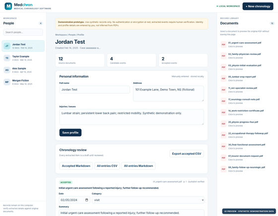

[](https://github.com/TomSellecksMustache/Medchron/actions/workflows/build.yml)

# Medchron

**Local-first medical chronology software — Rust prototype for document review and case organization.**

Medchron helps organize medical and insurance PDFs into a source-linked chronology for **human review**. The Windows edition runs a local Rust server and opens the workspace in your default browser. The application does not require a cloud AI service.

## Download for Windows

**[Download Medchron for Windows (.exe installer)](https://github.com/TomSellecksMustache/Medchron/releases/latest/download/Medchron-Setup-Windows-x64.exe)**

The installer is the **recommended download** for Windows x64. It installs Medchron in `C:\Program Files\Medchron`, adds a desktop shortcut, and launches the browser interface at **http://127.0.0.1:56753/**. See the [latest release](https://github.com/TomSellecksMustache/Medchron/releases/latest) for the portable ZIP and SHA-256 checksums.

**Synthetic demonstration records are included.** The Windows installer packages at least 30 fictional, clearly labeled PDF records under `samples/`, with copies made available in the user's local Medchron sample directory. No real patient files are included. See [Synthetic records](docs/guides/SYNTHETIC_RECORDS.md).

## People Workspace preview

<p align="center">
  <a href="docs/screenshots/people-workspace.png">
    
  </a>
</p>

<p align="center"><sub>Click to enlarge. Screenshot uses fictional demonstration records and mocked local API responses — not actual patient information.</sub></p>

The workspace includes a persistent, scrollable people directory on the left, the selected person's details and chronology in the center, and associated PDFs on the right. Selecting a document opens an in-page preview.

## Features

- **People and cases:** saved profiles with name, address, injury/issues, and an associated document list.
- **Source-linked chronology:** rule-based candidate extraction from searchable and scanned PDFs, with file and page references.
- **Offline OCR:** local Tesseract and Poppler extract text from image-only pages. OCR quotations remain unverified until checked against the source.
- **Reviewed batch intake:** analyze up to 30 PDFs, review each proposed person and destination, then confirm import. Existing people are selected explicitly; names alone never merge saved cases.
- **Human verification:** review, edit, accept, or reject suggested chronology entries against their source documents.
- **Local PDF preview:** view associated source PDFs in the browser workspace.
- **Exports:** CSV and Markdown chronology output.
- **Local processing:** Axum/Rust backend, local JSON storage, and no required external AI API.
- **Sample dataset:** synthetic medical and insurer PDF records for demonstration and testing.

## Getting started

### Windows (recommended)

1. Download the [latest Windows installer](https://github.com/TomSellecksMustache/Medchron/releases/latest/download/Medchron-Setup-Windows-x64.exe).
2. Install Medchron and launch it using the desktop or Start menu shortcut.
3. Medchron starts locally and opens `http://127.0.0.1:56753/` in your default browser.
4. Use the bundled **synthetic records** to create a demonstration case. In the installed version, look in `C:\Program Files\Medchron\samples\` or `%LOCALAPPDATA%\Medchron\sample\`.

The Windows server installs at `C:\Program Files\Medchron\bin\medchron-server.exe`. Case data is kept separately under `%LOCALAPPDATA%\Medchron\data` and is not automatically removed when the application is uninstalled. See [Windows installation details](docs/guides/WINDOWS_INSTALLER.md).

### Develop from source (Linux, Windows, or macOS)

Install the stable [Rust toolchain](https://rustup.rs/), then run:

```bash
# Ubuntu: install local OCR tools and English language data.
sudo apt install tesseract-ocr tesseract-ocr-eng poppler-utils
cargo test
cargo run --bin medchron
```

Source builds default to **http://127.0.0.1:56753/** unless `MEDCHRON_BIND` is set. The Windows launcher also uses port **56753**. On Windows or macOS source builds, install Tesseract, English language data, and Poppler locally and make their executables available on `PATH`.

To use a private data directory:

```bash
MEDCHRON_DATA=/path/to/private/medchron-data cargo run --bin medchron
```

The server rejects non-loopback bind addresses. Never expose this prototype through a public reverse proxy or tunnel.

## Offline OCR and batch intake

Single-person uploads use existing searchable text when available and fall back to local OCR for image-only pages. The Windows release workflow packages Tesseract, English language data, and Poppler with the installer and portable ZIP. OCR failures produce warnings so the original PDF can still be reviewed.

For PDFs from multiple people, open **Batch intake · multiple people**:

1. Select up to 30 PDFs, with a 25 MB limit per file and a 100 MB request limit.
2. Click **Analyze names locally**. Medchron suggests names only from explicitly labeled patient or client fields; this step saves no cases.
3. Review every name and choose **New person** or an explicit existing person. Different people may share a name, so check the source documents before grouping files.
4. Confirm the assignments and click **Import confirmed records**. The People sidebar and each person's document library update after import.

OCR entries require human quotation verification. CPU OCR is the default; the optional local CUDA/PaddleOCR adapter is experimental. See [OCR and storage notes](docs/OCR_BATCH_ENCRYPTION.md) for configuration and limitations.

The [v0.2.7 release](https://github.com/TomSellecksMustache/Medchron/releases/tag/v0.2.7) includes screenshots captured from the packaged application using fictional scanned PDFs.

## Repository layout

| Location | Purpose |
| --- | --- |
| `src/` | Rust server, models, chronology extraction, review logic, and Windows launcher |
| `static/index.html` | Local browser interface |
| `samples/` | Synthetic demonstration PDFs only |
| `docs/screenshots/` | UI preview images using fictional data |
| `packaging/windows/` | Inno Setup installer branding and packaging |
| `.github/workflows/build.yml` | Automatic Windows Rust build, test, and lint check for `main` |
| `.github/workflows/windows-release.yml` | Tagged Windows installer packaging and GitHub Release publishing |

## Privacy and limitations

**Prototype / demonstration software — not validated for legal, medical, or production use.** Use synthetic records only until an independent security, privacy, and compliance review is completed.

- Records and case metadata are processed and stored locally by the application. No cloud LLM integration is required.
- There is **no login/authentication**, built-in encryption at rest, or complete audit trail.
- Redaction and text extraction are heuristic. They are not guarantees of anonymization, completeness, or clinical/legal accuracy.
- OCR can misread identities, quotations, and dates. Suggestions and extracted events require human review.
- Storage is currently plaintext. The reserved `MEDCHRON_STORAGE_MODE=encrypted-v1` setting refuses startup; encryption and key management are not implemented.
- Every extracted event must be checked against the original source by a human reviewer.
- A loopback-only web server is not a security boundary against other processes on the same computer.
- **Do not commit client records, PII, case data, credentials, or logs containing identifiers to GitHub.**

## Build and releases

The **Windows Build** badge at the very top reports the result of the automatic Windows Rust checks for `main`. The separate installer-release workflow builds and publishes a Windows `.exe` for version tags, and stable releases are marked as **Latest** only after the installer is successfully built.

- [Latest stable release and downloads](https://github.com/TomSellecksMustache/Medchron/releases/latest)
- [All releases and release candidates](https://github.com/TomSellecksMustache/Medchron/releases)
- [Windows installer guide](docs/guides/WINDOWS_INSTALLER.md)

Release version: **v0.2.7**. Medchron remains in the `0.x` development series. See [v0.2.7 release notes](docs/releases/v0.2.7.md).

## License

MIT — see [LICENSE](LICENSE).
